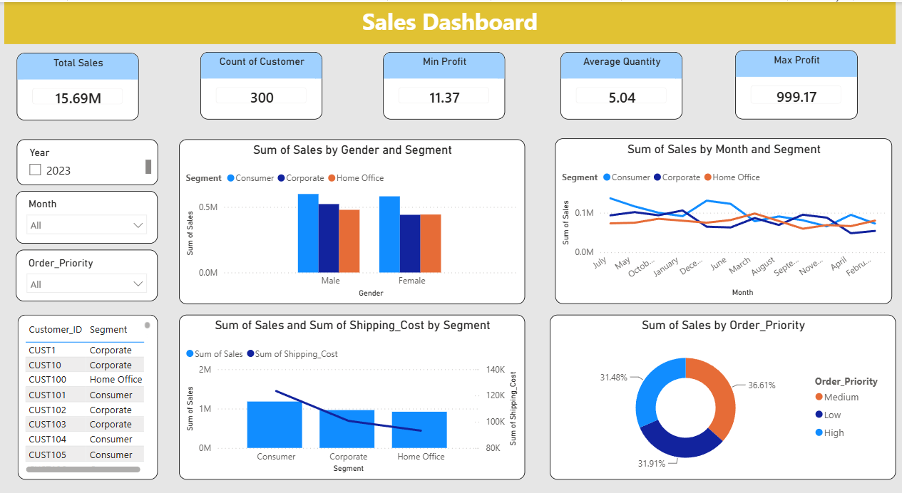

# 📊 Population Demographics Analysis

> Turning data into meaningful insights.

An interactive Power BI dashboard designed to explore data through visualizations, key metrics, and interactive filters.

## Dashboard

## Analysis

- Category-wise data analysis
- Monthly trends and comparisons
- Segment-wise performance
- Distribution analysis
- Interactive filtering by year and other categories

## Key Metrics

- Total Sales — 15.69M
- Customer Count — 300
- Minimum Profit — 11.37
- Average Quantity — 5.04
- Maximum Profit — 999.17

## Tools

**Power BI** · **Data Analysis** · **Data Visualization**

## Objective

Explore data through interactive dashboards and transform numerical information into clear, meaningful visual insights.

---

> "Good analysis turns data into understanding."
